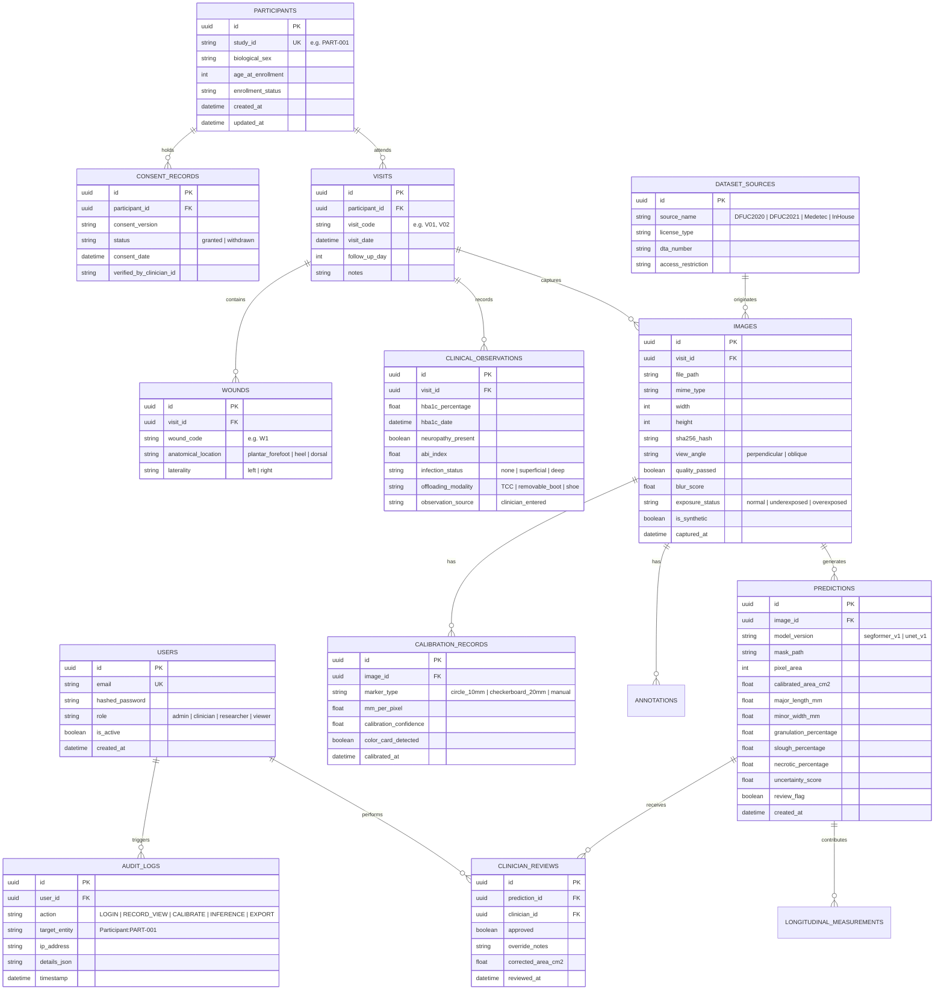

# DFU-XAI System Architecture & Data Model

## 1. High-Level Architecture Overview

DFU-XAI is designed as a secure, hybrid medical decision-support platform separating presentation, API orchestration, and machine learning computation:

```mermaid
graph TD
    subgraph Frontend ["Client Tier (Next.js 14 App Router)"]
        UI_Dash[Clinician Dashboard]
        UI_Capture[PWA Smartphone Capture]
        UI_Timeline[Longitudinal Progression View]
        UI_Admin[Audit & Admin Console]
        UI_Research[Research & Export Portal]
    end

    subgraph Backend ["Application Tier (FastAPI REST Server)"]
        API_GW[FastAPI Router /api/v1]
        Auth_SVC[RBAC & Auth Service (JWT / Argon2)]
        Img_SVC[Image Validation & EXIF Stripper]
        Calib_SVC[Calibration & Scale Estimation]
        Seg_SVC[Segmentation & Metric Inference]
        Long_SVC[Longitudinal Modeling Engine]
        Audit_SVC[Audit Trail Logger]
        Storage_SVC[Secure De-identified Object Storage]
    end

    subgraph DataTier ["Persistence Tier"]
        DB[(Relational DB: SQLite / PostgreSQL)]
        DiskStore[(Encrypted Filesystem / S3 Blob Store)]
    end

    subgraph MLTier ["ML Experimentation & Inference Tier"]
        SegFormer[SegFormer-B0 Head]
        UNet[U-Net Baseline]
        SSL_Exp[SSL Harness: DINOv2 / SimCLR / MAE]
        Fusion_M[Clinical Fusion: LightGBM / Logistic]
        XAI_Engine[Grad-CAM & SHAP Attributions]
        Uncertainty[MC Dropout / Calibrated Abstention]
    end

    UI_Dash -->|HTTPS / REST| API_GW
    UI_Capture -->|Secure Upload| API_GW
    UI_Timeline -->|REST / JSON| API_GW
    UI_Admin -->|REST / JSON| API_GW
    UI_Research -->|REST / JSON| API_GW

    API_GW --> Auth_SVC
    API_GW --> Img_SVC
    API_GW --> Calib_SVC
    API_GW --> Seg_SVC
    API_GW --> Long_SVC
    API_GW --> Audit_SVC

    Auth_SVC --> DB
    Img_SVC --> Storage_SVC
    Storage_SVC --> DiskStore
    Seg_SVC --> SegFormer
    Seg_SVC --> UNet
    Seg_SVC --> Uncertainty
    Long_SVC --> Fusion_M
    API_GW --> XAI_Engine
```

---

## 2. Relational Database Entity-Relationship (ER) Diagram

The system employs a normalized, audit-compliant relational schema:


